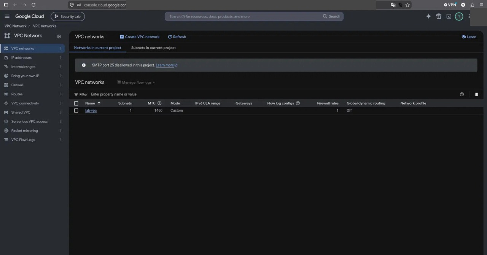
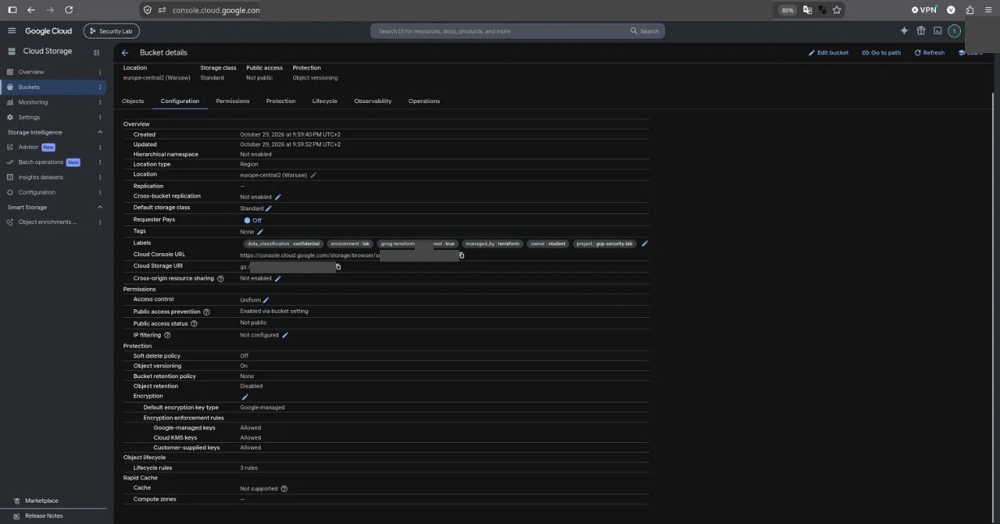
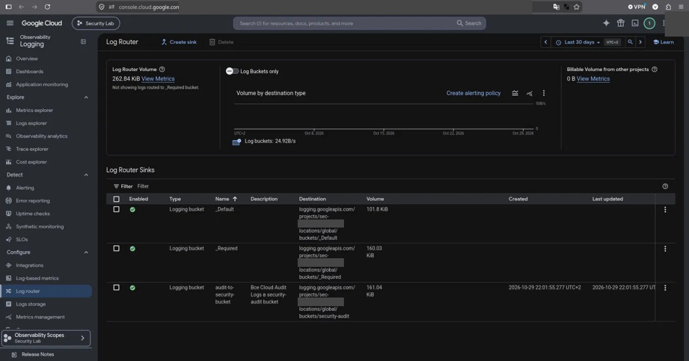

# GCP Security Hard Lab
## Структура

| Путь | Содержимое |
| --- | --- |
| `terraform/` | Инфраструктура как код: VPC, Cloud Storage, IAM (три роли), аудит-логи, детекты, алерты |
| `detections/` | Матрица обнаружений и запросы Logs Explorer/Log Analytics |
| `runbooks/` | Общий процесс реагирования, tabletop, runbooks RB-001…RB-006, экстренный доступ |
| `incidents/` | Шесть расследований IR-01…IR-06 (формат из 10 пунктов) |
| `compliance/` | Матрица контролей ISO 27001 (CSV) |
| `reports/` | Финальный отчёт |
| `docs/` | Архитектура, реестр активов, модель угроз, IAM review, безопасность Storage, Terraform-операции, журнал выполнения, публикация |
| `evidence/` | `architecture.png`, `screenshots/`, `sanitized-logs/` (без секретов) |
| `scripts/` | `verify.sh`, `drift-check.sh`, `test-versioning.sh`, `sanitize.sh`, `pre-push-check.sh`, `import-existing.sh` |

## Как развернуть

Нужны: `gcloud`, `terraform >= 1.5`, `git`, тестовый проект с billing.

```bash
gcloud auth login && gcloud auth application-default login
gcloud config set project PROJECT_ID
gcloud auth application-default set-quota-project PROJECT_ID
cd terraform
cp terraform.tfvars.example terraform.tfvars
terraform init && terraform plan -out=tfplan && terraform apply tfplan
cd .. && PROJECT_ID=PROJECT_ID bash scripts/verify.sh
```

Подробно: [docs/00-step-by-step.md](docs/00-step-by-step.md). Удаление: [docs/terraform-ops.md](docs/terraform-ops.md).

## Документы

- [Архитектура и потоки данных](docs/architecture.md) · [Реестр активов](docs/asset-registry.md) · [Модель угроз](docs/threat-model.md)
- [IAM review](docs/iam-review.md) · [Storage security](docs/storage-security.md) · [Terraform ops](docs/terraform-ops.md)
- [Детекты](detections/detection-matrix.md) · [Запросы](detections/queries.md) · [Tabletop](runbooks/tabletop.md)
- [Матрица ISO 27001](compliance/iso27001-control-matrix.csv) · [Финальный отчёт](reports/final-report.md) · [Журнал выполнения](docs/lab-journal.md)

## Безопасность репозитория

Не коммить `terraform.tfvars`, `*.tfstate`, ключи SA и токены. Это блокируют `.gitignore`, `pre-push-check.sh` и CI (gitleaks). Evidence очищается `sanitize.sh` и просматривается вручную.

## Оговорка

Результаты основаны на фактическом запуске в тестовом проекте GCP.

<!-- screenshots:Скриншоты -->
## Скриншоты



*После: остался только lab-vpc*



*Bucket: метки, шифрование, lifecycle*



*Log Router: sink audit-to-security-bucket*


