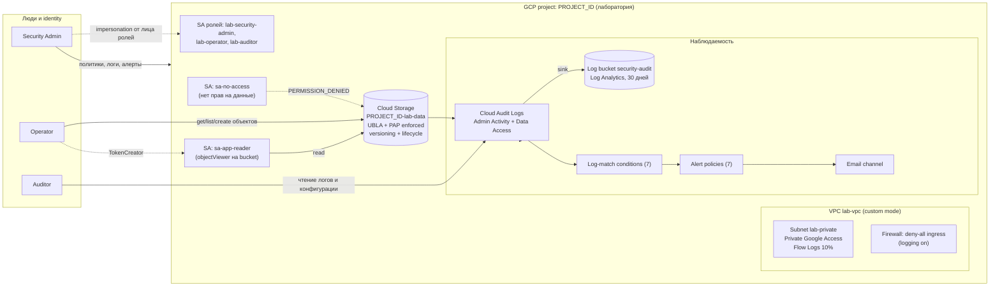
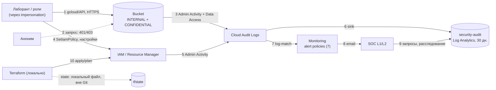

# 01. Архитектура

## Схема

## Диаграмма потоков данных

Границы доверия: интернет ↔ проект GCP (Public Access Prevention, deny-all ingress); человек ↔ роли (impersonation, нет ключей); проект ↔ репозиторий (секреты и state не передаются).

## Принципы

1. **Отдельный проект** для лаборатории, никаких production-ресурсов и реальных данных.
2. **Нет публичной поверхности**: нет внешних IP, нет VM, bucket с Public Access Prevention.
3. **Минимальные привилегии**: права на данные выдаются только на уровне bucket, без Owner/Editor.
4. **Нет долгоживущих ключей**: доступ тестовых identity через impersonation.
5. **Всё наблюдаемо**: Admin Activity + выборочные Data Access, отдельный log bucket, детекции с алертами.
6. **Воспроизводимость**: вся инфраструктура в Terraform, ручные изменения считаются дрейфом.

## Поток данных и логов

- Запрос к bucket → Cloud Storage → запись в Cloud Audit Logs (Data Access) → sink → `security-audit` bucket.
- Изменение IAM/политик → Admin Activity log (всегда включён) → sink + log-based metric → alert policy → email.

## Границы и допущения

- Один проект: логи хранятся в том же проекте, где работают ресурсы (в production лучше отдельный log project).
- Шифрование: Google-managed keys (CMEK не используется, см. отчёт).
- Организационных политик (Organization Policy) в лабе нет, если у тебя нет организации. Рекомендация в отчёте.
