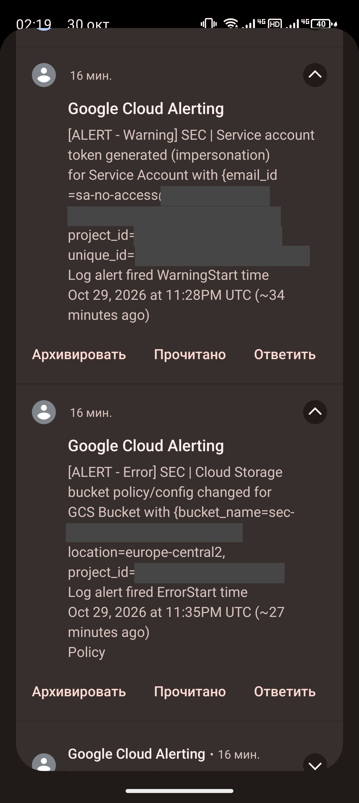

# Incident 01 (IR-01). Неожиданное изменение IAM на тестовом ресурсе

| Поле | Значение |
| --- | --- |
| Incident ID | INC-2026-10-01 (IR-01) |
| Severity | Высокая (ERROR) |
| Угрозы | T-01 (чрезмерные привилегии IAM), T-05 |
| Детекция | D-01 `SEC \| IAM policy changed`, D-02 |
| Runbook | [RB-003](../runbooks/suspicious-iam-change.md) |
| Контроли ISO 27001 | 5.15, 5.18, 8.2, 8.15, 8.16, 8.32 |

## Сценарий и воспроизведение

Контролируемое изменение: тестовой identity `sa-no-access`, у которой по модели нет прав на данные, выдаётся роль чтения на bucket. Нужно обнаружить изменение по логам, определить актора и время, оценить влияние и вернуть минимальные привилегии.

```bash
export PROJECT_ID=...; export BUCKET="${PROJECT_ID}-lab-data"
SA_NONE="sa-no-access@${PROJECT_ID}.iam.gserviceaccount.com"; SA_READER="sa-app-reader@${PROJECT_ID}.iam.gserviceaccount.com"
date -u +%FT%TZ
gcloud storage buckets get-iam-policy "gs://${BUCKET}" --format=json > evidence/raw/ir-01-iam-before.json
gcloud storage buckets add-iam-policy-binding "gs://${BUCKET}" --member="serviceAccount:${SA_NONE}" --role=roles/storage.objectViewer
# влияние: identity читает CONFIDENTIAL
gcloud storage cat "gs://${BUCKET}/confidential/finance-report-SYNTHETIC.csv" --impersonate-service-account="$SA_NONE"
# откат
gcloud storage buckets remove-iam-policy-binding "gs://${BUCKET}" --member="serviceAccount:${SA_NONE}" --role=roles/storage.objectViewer
```

## 1. Incident ID и severity

INC-2026-10-01, IR-01, severity: **Высокая (ERROR)**.

## 2. Временная шкала (UTC)

| Время UTC | Событие | Источник |
| --- | --- | --- |
| 23:35:17 | Изменение IAM bucket (`storage.setIamPermissions`), актор — владелец лабы | Admin Activity |
| ≈23:35 | Письма `SEC \| Cloud Storage bucket policy/config changed` и `SEC \| IAM policy changed` | Gmail, Monitoring |
| после изменения | Identity прочитала синтетический CONFIDENTIAL CSV (подтверждение влияния) | Вывод команды, Data Access |
| после отката | Повторная проверка: доступ отклонён (403), `verify.sh` без ошибок | Терминал |

## 3. Подтверждённые события и источники

| Факт | Источник / поле | Значение |
| --- | --- | --- |
| Актор | `authenticationInfo.principalEmail` | Владелец лабы |
| Ресурс | `resourceName` | Bucket лаборатории |
| Изменение | `policyDelta.bindingDeltas` | ADD роли чтения для тестовой identity |
| Видит ли Terraform | `terraform plan -detailed-exitcode` | exit 0: дрейф не виден, привязки аддитивные (находка F-01) |

## 4. Гипотезы и их проверка

| Гипотеза | Как проверена | Результат |
| --- | --- | --- |
| Изменение плановое (Terraform/PR) | Сверка с Git и `terraform plan` | Опровергнута: изменения нет в коде |
| Новые права реально использовались | Чтение CONFIDENTIAL от этой identity | Подтверждена: данные прочитаны |
| Компрометация аккаунта актора | IP и user agent соответствуют лаборанту | Опровергнута: действие лаборанта в рамках симуляции |

## 5. Оценка влияния

Identity без прав на данные получила чтение CONFIDENTIAL; влияние подтверждено чтением синтетического файла. В реальной среде — утечка. Возможность появилась сразу после изменения политики, алерт пришёл в течение около минуты.

## 6. Containment

Выдана привязка удалена (`remove-iam-policy-binding`). Окно экспозиции — время между добавлением и откатом.

## 7. Root cause

Принципал с правом `setIamPolicy` на bucket может выдать роль любой identity; ручная привязка не отражается в Terraform-коде, а `terraform plan` её не видит (аддитивные `*_iam_member`).

## 8. Remediation

Снять привязку; для контроля дрейфа использовать authoritative-ресурсы (`google_storage_bucket_iam_binding/policy`) или периодическую сверку через Policy Analyzer/Asset Inventory; ограничить, кто имеет `setIamPolicy`.

## 9. Проверка после исправления

Повторное чтение под тестовой identity отклоняется (403); `bash scripts/verify.sh` выполняется без ошибок.

## 10. Lessons learned

Алерт D-01 обнаруживает изменение быстро, но не показывает, опасна ли выданная роль. `terraform plan` не заменяет аудит политики: ручные привязки он не обнаруживает.

## Доказательства

- Письма алертов: `evidence/screenshots/19-email-alerts.png`, `19-email-alerts-phone.png`
- Лог `setIamPermissions` с `bindingDeltas`, IAM-политика до/после, вывод `terraform plan` (exit 0), вывод `verify.sh` после отката — в `evidence/sanitized-logs/`

<!-- screenshots:Скриншоты -->
## Скриншоты


*Письма алертов*



*Уведомления алертов на телефоне*
