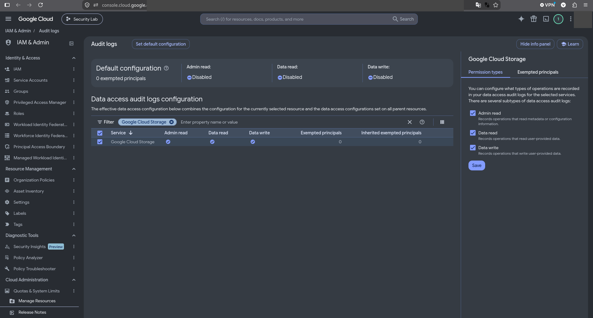
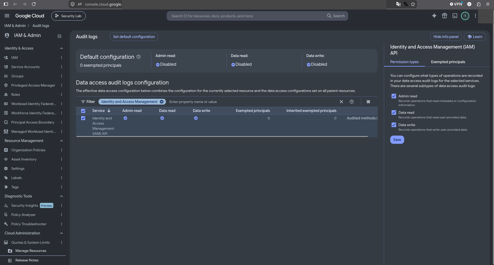

# Incident 04 (IR-04). Изменение конфигурации аудита

| Поле | Значение |
| --- | --- |
| Incident ID | INC-2026-10-04 (IR-04) |
| Severity | Критическая (CRITICAL) |
| Угрозы | T-04 (изменение настроек логирования) |
| Детекция | D-04 `SEC \| Audit configuration changed` |
| Runbook | [RB-005](../runbooks/audit-tampering.md) |
| Контроли ISO 27001 | 5.28, 8.15, 8.16, 8.32 |

## Сценарий и воспроизведение

Злоумышленник скрывает чтение данных, добавляя identity в `exemptedMembers` для `DATA_READ` Cloud Storage. Безопасность: меняется один сервис для одной тестовой identity, аудит всего проекта **не отключается**, изменение откатывается сразу.

```bash
WORK=$(mktemp -d); date -u +%FT%TZ
gcloud projects get-iam-policy "$PROJECT_ID" --format=json > "$WORK/before.json"
jq --arg m "serviceAccount:${SA_NONE}" '(.auditConfigs[] | select(.service=="storage.googleapis.com") | .auditLogConfigs[] | select(.logType=="DATA_READ")).exemptedMembers = [$m]' "$WORK/before.json" > "$WORK/after.json"
gcloud projects set-iam-policy "$PROJECT_ID" "$WORK/after.json"
( cd terraform && terraform plan -detailed-exitcode )     # exit 2: дрейф
( cd terraform && terraform apply )                        # откат: возвращает audit config из кода
```

## 1. Incident ID и severity

INC-2026-10-04, IR-04, severity: **Критическая (CRITICAL)**.

## 2. Временная шкала (UTC)

| Время UTC | Событие | Источник |
| --- | --- | --- |
| 23:40:04 | Изменение audit config (exempted member для DATA_READ Storage); письмо CRITICAL `SEC \| Audit configuration changed` | Admin Activity (Resource Manager), Gmail |
| — | `terraform plan` показал дрейф (exit 2) | Терминал |
| 23:41:56 (+1 мин 52 с) | Возврат audit config через `terraform apply` | Admin Activity |

## 3. Подтверждённые события и источники

| Факт | Источник / поле | Значение |
| --- | --- | --- |
| Что изменено | `auditConfigDeltas` | Добавлен exempted member для `DATA_READ` Cloud Storage |
| Окно «слепоты» | время изменения и отката | ≈1 мин 52 с |
| Дрейф виден Terraform | `terraform plan -detailed-exitcode` | exit 2 (в отличие от IR-01 и IR-06) |

## 4. Гипотезы и их проверка

| Гипотеза | Как проверена | Результат |
| --- | --- | --- |
| Изменение плановое | Сверка с Git/`terraform apply` | Опровергнута |
| Алерт — единственный источник | Сравнение с `terraform plan` | Нет: `terraform plan` — второй независимый источник |

## 5. Оценка влияния

В окне ≈1 мин 52 с чтения exempted identity по Storage не логировались: эти действия непроверяемы по Data Access. Реального доступа к данным в окне не выполнялось.

## 6. Containment

Audit config возвращён из Terraform; exempted member удалён.

## 7. Root cause

Принципал с `resourcemanager.projects.setIamPolicy` может ослабить аудит; логи и алерты находятся в том же проекте, где работает нарушитель.

## 8. Remediation

Вернуть конфигурацию (выполнено); вынести аудит в отдельный log project и organization-level sink; заблокировать (lock) log bucket; ограничить `setIamPolicy`.

## 9. Проверка после исправления

`gcloud projects get-iam-policy --format='json(auditConfigs)'` — exempted members отсутствуют; `terraform plan` — No changes; `verify.sh` без ошибок.

## 10. Lessons learned

Пробел в телеметрии замечают: алерт D-04, дрейф `terraform plan`, Cloud Asset history. Защита логов: отдельный проект, lock bucket, минимальные права `setIamPolicy`.

## Доказательства

- Выписка Admin Activity (две записи `SetIamPolicy` с `auditConfigDeltas`: 23:40:04 и 23:41:56 UTC 29.10; более ранние относятся к развёртыванию): `evidence/sanitized-logs/ir-04-audit-config.json`
- Письмо CRITICAL: `evidence/screenshots/19-email-alerts.png`
- Конфигурация аудита: `evidence/screenshots/12a-audit-storage.png`, `12b-audit-iam.png`
- `auditConfigDeltas`, `terraform plan` до и после — `evidence/sanitized-logs/`

<!-- screenshots:Скриншоты -->
## Скриншоты


*Письма алертов*



*Audit config: Cloud Storage*



*Audit config: IAM API*
