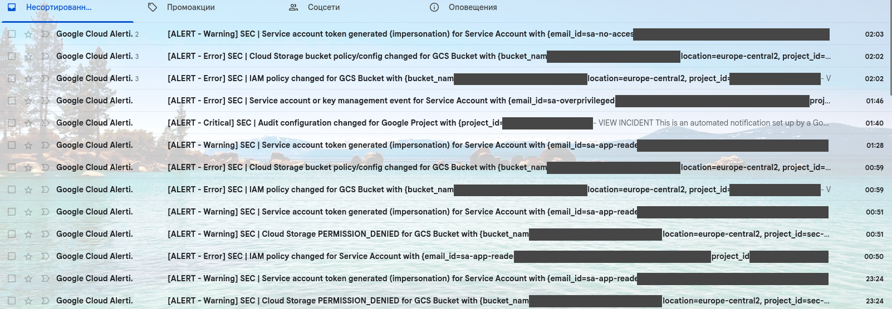
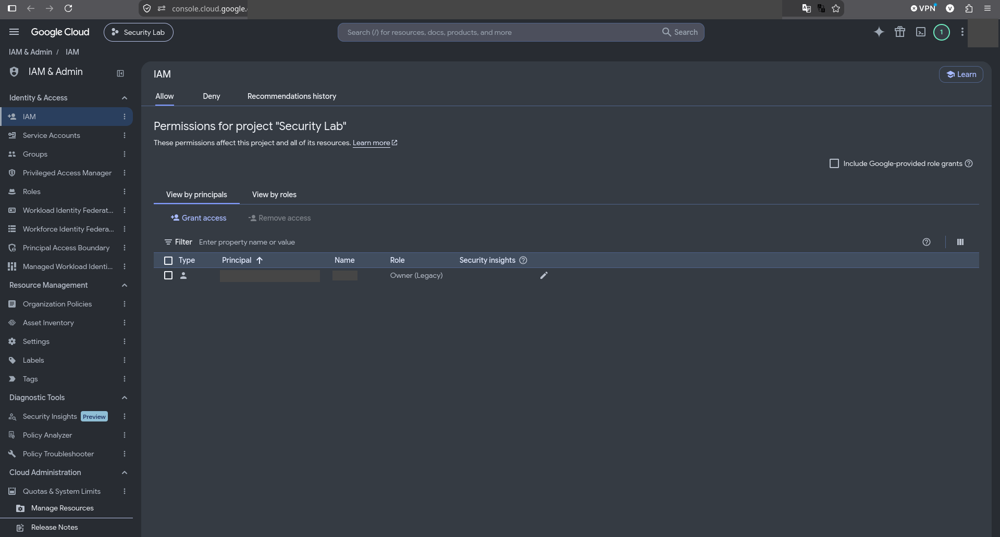

# Incident 05 (IR-05). Избыточные привилегии service account

| Поле | Значение |
| --- | --- |
| Incident ID | INC-2026-10-05 (IR-05) |
| Severity | Высокая (ERROR) |
| Угрозы | T-01 (чрезмерные привилегии), T-05, T-06 |
| Детекция | D-01, D-03 |
| Runbook | [RB-004](../runbooks/service-account-privileges.md) |
| Контроли ISO 27001 | 5.15, 5.16, 5.18, 8.2, 8.3 |

## Сценарий и воспроизведение

Находим service account с избыточной ролью, фиксируем права, обосновываем избыточность, оцениваем влияние компрометации, сокращаем разрешения и повторно проверяем. Ключи **не создаются**.

```bash
gcloud iam service-accounts create sa-overprivileged --display-name="IR-05 overprivileged test SA"
gcloud projects add-iam-policy-binding "$PROJECT_ID" --member="serviceAccount:sa-overprivileged@${PROJECT_ID}.iam.gserviceaccount.com" --role=roles/storage.admin
gcloud projects get-iam-policy "$PROJECT_ID" --flatten='bindings[].members' --filter='bindings.members:sa-overprivileged' --format='table(bindings.role)'
gcloud iam roles describe roles/storage.admin --format='value(includedPermissions)' | tr ';' '\n' | wc -l
# сокращение прав и очистка
gcloud projects remove-iam-policy-binding "$PROJECT_ID" --member="serviceAccount:sa-overprivileged@${PROJECT_ID}.iam.gserviceaccount.com" --role=roles/storage.admin
gcloud iam service-accounts delete "sa-overprivileged@${PROJECT_ID}.iam.gserviceaccount.com" --quiet
```

## 1. Incident ID и severity

INC-2026-10-05, IR-05, severity: **Высокая (ERROR)**.

## 2. Временная шкала (UTC)

| Время UTC | Событие | Источник |
| --- | --- | --- |
| 23:45:40 | Создание `sa-overprivileged` (`CreateServiceAccount`) | Admin Activity (IAM) |
| 23:45:44 | `SetIamPolicy` на проект: выдача `roles/storage.admin` | Admin Activity (Resource Manager) |
| ≈23:46 | Письмо `SEC \| Service account or key management event` | Gmail, Monitoring |
| после | Анализ прав; снятие роли | Admin Activity |
| 23:47:07 | Удаление `sa-overprivileged` (`DeleteServiceAccount`) | Admin Activity (IAM) |
| после | Найдена и снята `roles/editor` у default compute service account | IAM-политика проекта |

## 3. Подтверждённые события и источники

| Факт | Источник / поле | Значение |
| --- | --- | --- |
| Права `sa-overprivileged` | `get-iam-policy` | `roles/storage.admin` на проект: 113 разрешений |
| Лишние права у служебных SA | `get-iam-policy` | `roles/editor` у default compute SA (выдана автоматически при включении Compute API) |
| Итоговая политика проекта | IAM, `evidence/screenshots/11-iam-principals.png` | Только владелец лабы (Owner) |

## 4. Гипотезы и их проверка

| Гипотеза | Как проверена | Результат |
| --- | --- | --- |
| Роль нужна для задачи | Сравнение с `docs/iam-review.md` | Нет: достаточно `objectViewer` на bucket |
| Другие SA тоже избыточны | Инвентаризация проектных ролей | Да: Editor у default compute SA |

## 5. Оценка влияния

Компрометация SA со `storage.admin` на проекте дала бы чтение, запись и удаление объектов во всех bucket проекта и изменение их IAM. Editor у default compute SA — латентный риск: VM нет, но роль широкая.

## 6. Containment

Снята избыточная роль, `sa-overprivileged` удалена, у default compute SA снята `roles/editor`.

## 7. Root cause

Выдача роли на уровне проекта вместо bucket; Google автоматически выдаёт Editor default compute SA при включении Compute API (при отсутствии Organization Policy).

## 8. Remediation

Минимальные привилегии: роли на уровне bucket, кастомные роли; отключение автогрантов (Organization Policy `iam.automaticIamGrantsForDefaultServiceAccounts`); регулярный аудит IAM.

## 9. Проверка после исправления

В политике проекта остаётся только Owner владельца лабы; доступ SA к CONFIDENTIAL без роли отклоняется; `bash scripts/verify.sh` выполняется без ошибок.

## 10. Lessons learned

Автоматические гранты служебным SA — частый источник избыточных прав: обнаруживаются инвентаризацией IAM, а не алертами. Сценарий не требовал создавать ключи.

## Доказательства

- Выписки Admin Activity: `evidence/sanitized-logs/ir-05-sa-events.json`, `ir-05-project-iam.json` (в последнем также записи других сценариев и развёртывания)
- Письмо алерта: `evidence/screenshots/19-email-alerts.png`
- Политика проекта после: `evidence/screenshots/11-iam-principals.png`
- Вывод `get-iam-policy` до и после — `evidence/sanitized-logs/`

<!-- screenshots:Скриншоты -->
## Скриншоты



*Письма алертов*



*IAM: итоговые principals проекта*
