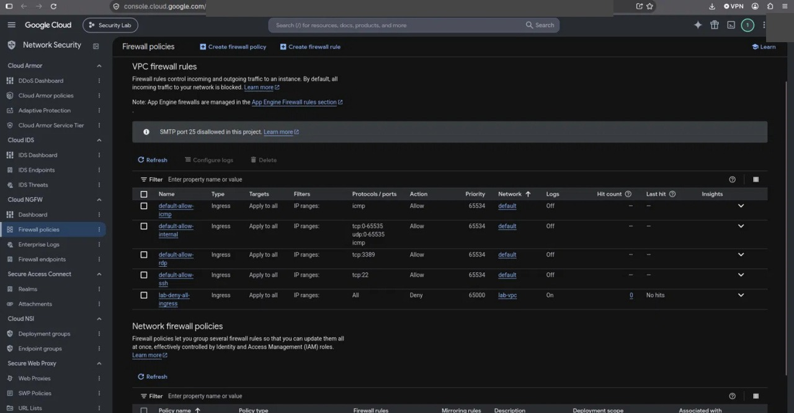

# Incident 06 (IR-06). Неожиданный ресурс или внешний endpoint (дрейф)

| Поле | Значение |
| --- | --- |
| Incident ID | INC-2026-10-06 (IR-06) |
| Severity | Средняя (ERROR) |
| Угрозы | T-07 (неожиданный внешний endpoint) |
| Детекция | Cloud Asset Inventory, `scripts/drift-check.sh`; после инцидента добавлен D-07 |
| Runbook | [RB-006](../runbooks/unexpected-resource.md) |
| Контроли ISO 27001 | 5.9, 8.9, 8.20, 8.22, 8.32 |

## Сценарий и воспроизведение

В сети лаборатории создаётся ресурс вне Terraform (временное firewall-правило, разрешающее внешний вход). VM нет, публичных ресурсов не создаётся. Нужно обнаружить расхождение с принятой архитектурой по инвентаризации или дрейфу, оценить экспозицию, сдержать и проверить.

```bash
gcloud compute firewall-rules create lab-tmp-allow-ssh --network=lab-vpc --direction=INGRESS --action=ALLOW --rules=tcp:22 --source-ranges=0.0.0.0/0 --priority=1000
bash scripts/drift-check.sh                                   # terraform plan + Asset Inventory
gcloud compute instances list; gcloud compute addresses list    # что это правило открывает
gcloud compute firewall-rules delete lab-tmp-allow-ssh --quiet
```

## 1. Incident ID и severity

INC-2026-10-06, IR-06, severity: **Средняя (ERROR)**.

## 2. Временная шкала (UTC)

| Время UTC | Событие | Источник |
| --- | --- | --- |
| 23:47:40 | Создание правила `lab-tmp-allow-ssh` вне Terraform (`compute.firewalls.insert`) | Admin Activity (Compute) |
| — | `terraform plan`: exit 0, ресурс не виден | Терминал |
| — | Правило найдено инвентаризацией (`firewall-rules list`, Asset Inventory) | gcloud |
| — | Алерта на изменение firewall не было | Monitoring |
| 23:49:34 | Правило удалено (`compute.firewalls.delete`) | Admin Activity |

## 3. Подтверждённые события и источники

| Факт | Источник / поле | Значение |
| --- | --- | --- |
| Что создано | `compute.firewalls.insert` | Правило ingress tcp:22 из `0.0.0.0/0` |
| Видит ли Terraform | `terraform plan -detailed-exitcode` | exit 0: ресурсы вне конфигурации не обнаруживаются |
| Время жизни правила | `insert` → `delete` | ≈1 мин 54 с (23:47:40 → 23:49:34) |
| Экспозиция | `instances list`, `addresses list` | VM и внешних IP нет: фактической экспозиции нет |
| Алерт | Monitoring | Не сработал: детекта на сетевые изменения тогда не было |

## 4. Гипотезы и их проверка

| Гипотеза | Как проверена | Результат |
| --- | --- | --- |
| Ресурс плановый | Код, реестр активов | Опровергнута |
| Есть реальная экспозиция | Нет VM и внешних IP в сети | Опровергнута, но правило открыло бы любую будущую VM в `lab-vpc` |
| Детекция была | Письма алертов | Опровергнута: слепое пятно |

## 5. Оценка влияния

Потенциальная экспозиция сети: правило допускает SSH из интернета для любой VM в `lab-vpc`. Фактической нет. Владелец и назначение: лаборант, тест.

## 6. Containment

Правило удалено (альтернатива — `--disabled`).

## 7. Root cause

Возможность создавать сетевые ресурсы вне Terraform и отсутствие детекта на изменения сети.

## 8. Remediation

Добавлена детекция D-07 (`unexpected_compute_change`) на `compute.firewalls/networks/subnetworks/routes/addresses/instances`; план — запрет создания сетевых ресурсов вне Terraform (роли, Organization Policy), регулярный `drift-check.sh`, Cloud Asset Inventory как источник истины.

## 9. Проверка после исправления

`gcloud compute firewall-rules list` — только `lab-deny-all-ingress`; `drift-check.sh` не находит лишних ресурсов; `verify.sh` без ошибок.

## 10. Lessons learned

`terraform plan` сообщает только о дрейфе управляемых ресурсов; неуправляемые ресурсы находят инвентаризация и логи. Слепое пятно детекции устраняется добавлением алерта по результатам расследования.

## Доказательства

- Выписка Admin Activity (`insert` 23:47:40 и `delete` 23:49:34 UTC 29.10; записи 19:59 и 21:18 относятся к развёртыванию и удалению default VPC): `evidence/sanitized-logs/ir-06-firewall.json`
- Список правил firewall и вывод `drift-check.sh` — `evidence/sanitized-logs/`
- Правила firewall до исправлений: `evidence/screenshots/02-firewall-before.jpg`

<!-- screenshots:Скриншоты -->
## Скриншоты



*До: default-allow-ssh/rdp из интернета*
