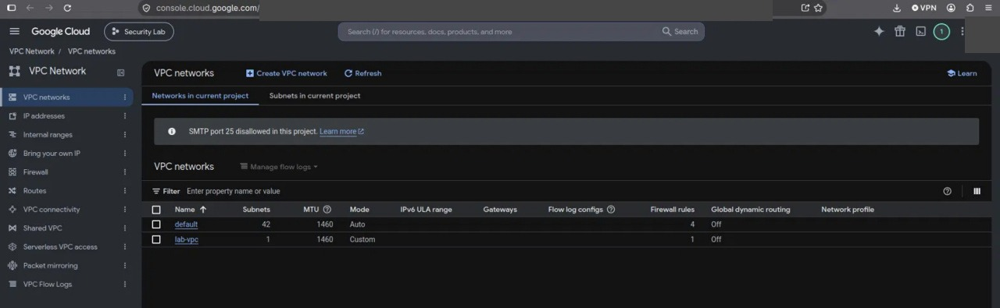
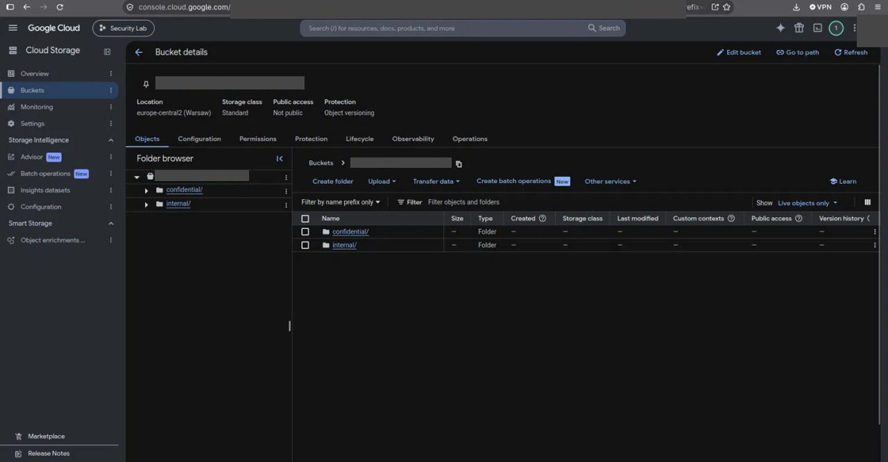
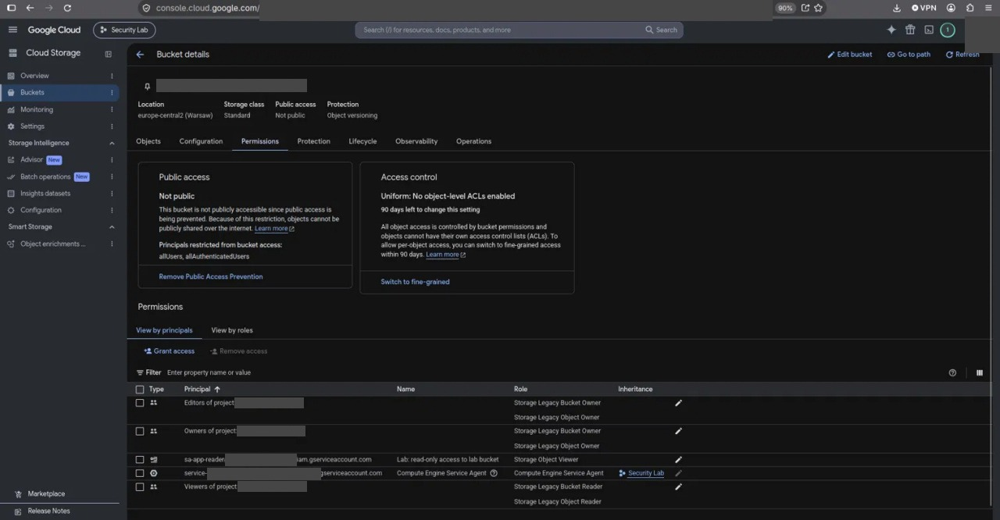
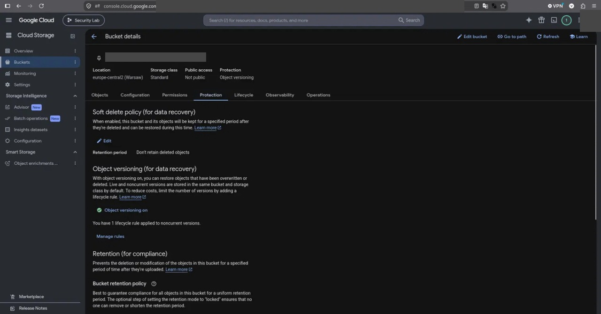
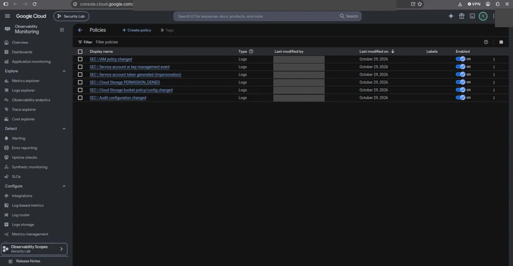
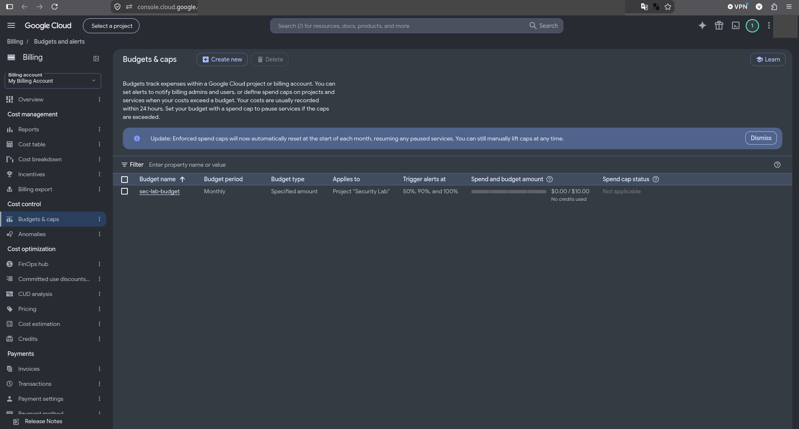
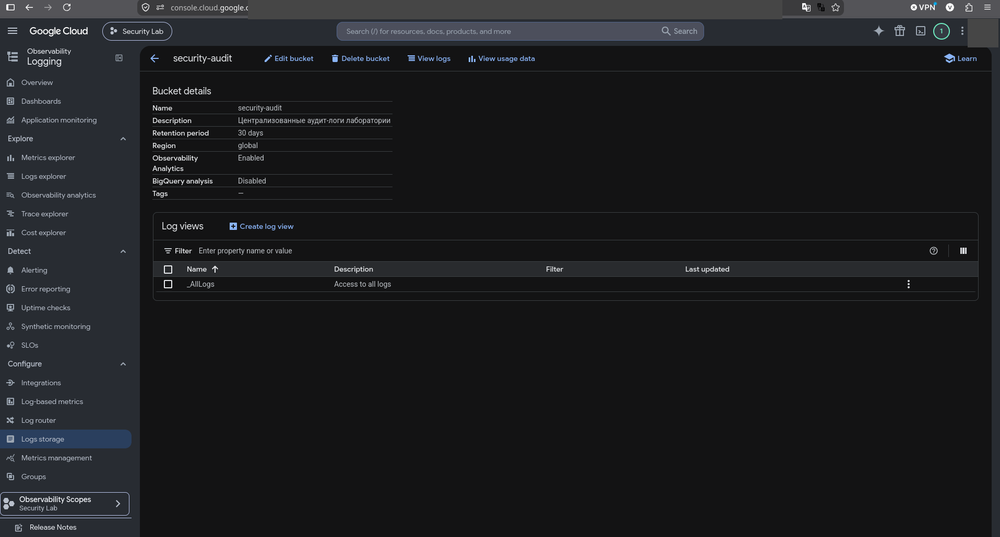

# Финальный отчёт: GCP Security Hard Lab

Дата: 2026-10-30 · Проект: `PROJECT_ID` (скрыт) · Регион: `europe-central2` · Стандарт: ISO/IEC 27001:2022 (учебное сопоставление, не сертификация)

## 1. Executive Summary

В отдельном тестовом проекте GCP развёрнута и проверена инфраструктура безопасности: custom VPC без внешних IP, bucket с синтетическими данными (UBLA, Public Access Prevention, versioning, lifecycle), IAM с разделением трёх ролей и без долгоживущих ключей, централизованное логирование (Admin Activity, Data Access для Storage и IAM, отдельный log bucket) и log-based алерты с email. Проверка конфигурации `scripts/verify.sh` проходит без ошибок (последний полный прогон: PASS=20, FAIL=0). Проведено шесть расследований (IR-01…IR-06): алерты приходят примерно через минуту после события. Главные находки: default VPC с открытыми SSH/RDP и Editor у default compute SA создаются автоматически при включении Compute API; на bucket унаследованы legacy-роли проектных групп; `terraform plan` не видит ручные IAM-привязки и ресурсы вне кода; алерта на успешное чтение CONFIDENTIAL нет; по итогам IR-06 добавлен детект на изменения сети и compute. Учебное сопоставление ISO 27001: 15 контролей реализовано, 10 частично, 1 неприменим.

## 2. Scope и архитектура

- Один тестовый проект GCP, синтетические данные, нет production и реальных ПДн. Регион `europe-central2`.
- Сервисы: Compute (только VPC/firewall), Cloud Storage, IAM, Cloud Logging/Audit Logs, Cloud Monitoring, Cloud Asset Inventory, Billing Budgets.
- Не используются: Cloud Run, Security Command Center (нужна организация), VM, внешние IP. Ограничение и альтернатива: `verify.sh`, `drift-check.sh`, Asset Inventory.
- Схема: [evidence/architecture.png](../evidence/architecture.png), потоки данных: [evidence/data-flow.png](../evidence/data-flow.png), описание: [docs/architecture.md](../docs/architecture.md).

## 3. Реестр активов

См. [docs/asset-registry.md](../docs/asset-registry.md): ресурсы, identities, журналы (срок хранения, права чтения).

## 4. Модель угроз

12 угроз с оценкой «до/после» и контролями трёх классов: [docs/threat-model.md](../docs/threat-model.md).

## 5. Реализованные меры защиты

| Область | Мера | Доказательство |
| --- | --- | --- |
| Сеть | Custom VPC, deny-all ingress с логированием, default VPC удалена, нет внешних IP/VM | `evidence/screenshots/01…03`, `verify.sh` |
| Storage | UBLA, Public Access Prevention, versioning, lifecycle, метки классификации | `evidence/screenshots/04…07` |
| IAM | Роли на уровне bucket, custom role, три SA-роли, нет ключей | `terraform/iam.tf`, `verify.sh` |
| Логирование | Admin Activity, Data Access (Storage, IAM), sink в `security-audit` | `evidence/screenshots/09, 12a, 12b, 13` |
| Обнаружение | Семь log-based алертов с email и runbooks | `evidence/screenshots/08, 19` |
| Процесс | Runbooks, tabletop, экстренный доступ | `runbooks/` |
| Репозиторий | `.gitignore`, pre-push check, gitleaks в CI | `.github/workflows/ci.yml` |

## 6. IAM review

Матрица доступа, обоснования, сравнение до/после: [docs/iam-review.md](../docs/iam-review.md). Результаты: снят Editor у default compute SA, снята избыточная роль SA (IR-05), в политике проекта остался только владелец лабы; разделение ролей проверяется `verify.sh`.

## 7. Storage security

[docs/storage-security.md](../docs/storage-security.md). Анонимный доступ: 403. Восстановление после перезаписи проверяется `scripts/test-versioning.sh`.

## 8. Logging и detection coverage

Матрица детектов и запросы: [detections/detection-matrix.md](../detections/detection-matrix.md), [detections/queries.md](../detections/queries.md).

| Детект | Сработал в симуляции | Время до письма | Комментарий |
| --- | --- | --- | --- |
| D-01 IAM policy changed | Да (IR-01, IR-05) | ≈1 мин |  |
| D-02 Storage policy changed | Да (IR-01, IR-02) | ≈1 мин | Срабатывает и на отклонённую попытку |
| D-03 SA management | Да (IR-05) | ≈1 мин |  |
| D-04 Audit config changed | Да (IR-04) | ≈1 мин | CRITICAL |
| D-05 PERMISSION_DENIED | Да (IR-03) | ≈1 мин |  |
| D-06 Impersonation | Да (IR-03) | ≈1 мин |  |
| D-07 Compute/network change | Нет (детекта не было) | — | Добавлен по итогам IR-06 (в самом инциденте алерта не было) |
| D-08 Успешный доступ к CONFIDENTIAL | Нет алерта | n/a | Ручная процедура, ограничение |

Хранение: Admin Activity 400 дней (`_Required`), Data Access и `security-audit` 30 дней.

## 9. Результаты шести расследований

| ID | Сценарий | Severity | Алерт | Итог | Файл |
| --- | --- | --- | --- | --- | --- |
| IR-01 | Изменение IAM на bucket | Высокая | Да | Обнаружено, откат; `terraform plan` дрейф не показал (F-01) | [incident-01](../incidents/incident-01.md) |
| IR-02 | Попытка публикации bucket | Высокая | Да | Заблокировано PAP, 403 | [incident-02](../incidents/incident-02.md) |
| IR-03 | Подозрительный доступ к объектам | Средняя | Да (отказы, impersonation) | Телеметрии достаточно для атрибуции; алерта на успех нет | [incident-03](../incidents/incident-03.md) |
| IR-04 | Изменение audit config | Критическая | Да (CRITICAL) | Обнаружено, окно ≈1 мин 52 с, откат Terraform | [incident-04](../incidents/incident-04.md) |
| IR-05 | Избыточные права SA | Высокая | Да | Роль снята; найден Editor у default compute SA | [incident-05](../incidents/incident-05.md) |
| IR-06 | Неожиданный ресурс (firewall) | Средняя | Нет (слепое пятно, добавлен D-07) | Terraform не видит; добавлен D-07 | [incident-06](../incidents/incident-06.md) |

Tabletop: [runbooks/tabletop.md](../runbooks/tabletop.md).

## 10. ISO control mapping

[compliance/iso27001-control-matrix.csv](../compliance/iso27001-control-matrix.csv): реализовано 15, частично 10, неприменимо 1 (всего 26 контролей). Это учебное сопоставление: применимость определяется Statement of Applicability организации.

## 11. Risk register (остаточные риски)

| ID | Риск / находка | Вер. | Влияние | Приоритет | Владелец | План устранения |
| --- | --- | --- | --- | --- | --- | --- |
| F-01 | Аддитивный IAM не показывает ручные лишние привязки в `terraform plan` | 3 | 4 | Высокий | Cloud Security Eng. | Authoritative-привязки или Policy Analyzer; регулярный аудит |
| F-02 | Унаследованные legacy-роли проектных групп на bucket (Editors/Viewers имеют доступ к данным) | 4 | 4 | Высокий | Cloud Security Eng. | Снять привязки (`docs/storage-security.md`), проверить `verify.sh` |
| F-03 | Нет Organization Policy и SCC (нет организации) | 3 | 4 | Средний | Cloud Security Eng. | Организация, constraints (запрет ключей SA, public access, автогранты) |
| F-04 | Лаборант — Owner с TokenCreator на все тестовые SA (компромисс стенда) | 3 | 4 | Средний | Владелец проекта | Убрать после лабы; break-glass по процедуре |
| F-05 | Terraform state локальный; потерян при смене компьютера, восстановлен импортом | 3 | 3 | Средний | DevOps | Backend GCS с versioning, блокировка state |
| F-06 | Логи 30 дней, тот же проект, log bucket не locked | 3 | 3 | Средний | SOC Lead | Отдельный log project, срок по политике (например, 365 дней), lock |
| F-07 | Нет алерта на успешное чтение CONFIDENTIAL (D-08) | 3 | 4 | Средний | Detection Eng. | Метрика/алерт по объекту и identity, порог по частоте |
| F-08 | Data Access включён только для Storage и IAM; остальное без Data Access | 2 | 3 | Низкий | SOC Lead | Расширять по оценке риска и стоимости |
| F-09 | Default VPC и правила SSH/RDP из интернета создавались автоматически (устранено) | 4 | 4 | Закрыт | Cloud Security Eng. | Удалить default VPC сразу после включения Compute API; запретить через Org Policy |
| F-10 | Editor у default compute SA при включении Compute API (устранено) | 4 | 4 | Закрыт | Cloud Security Eng. | Org Policy `iam.automaticIamGrantsForDefaultServiceAccounts` |
| F-11 | Оповещения только на email, лимит 5 минут | 3 | 2 | Низкий | SOC Lead | Интеграция с SIEM/ChatOps/on-call |
| F-12 | CMEK не используется; `force_destroy` и не-locked retention (удобство лабы) | 2 | 2 | Низкий | Cloud Security Eng. | CMEK, locked retention, `force_destroy=false` в production |
| F-13 | Бюджет создан вручную и только уведомляет | 3 | 2 | Низкий | Владелец проекта | Бюджет в Terraform, автоотключение billing по Pub/Sub |
| F-14 | MFA владельца не подтверждена скриншотом | 2 | 5 | Средний | Владелец проекта | Включить и подтвердить (ISO A.5.17, A.8.5) |

Вероятность и влияние: 1–5, приоритет — по произведению (≥15 высокий, 8–14 средний, <8 низкий). Статусы подтверди по своим данным.

## 12. Remediation roadmap

| Период | Действия |
| --- | --- |
| 0–7 дней (критично) | F-02 снять legacy-роли на bucket; F-14 MFA; F-01 добавить регулярный аудит IAM; проверка `verify.sh`/`drift-check.sh` |
| 8–30 дней | F-05 backend state; F-06 отдельный log project, retention 365 дней, lock; F-07 алерт на CONFIDENTIAL; F-04 убрать Owner у лаборанта |
| 31–90 дней | F-03 Organization и Org Policy, SCC; F-11 SIEM/on-call; F-12 CMEK и locked retention; F-13 автоматизация бюджета; сегментация при появлении нагрузок |

## 13. Teardown и оценка расходов

- Удаление: `terraform destroy`, проверка Asset Inventory, консоль, при необходимости удаление проекта ([docs/terraform-ops.md](../docs/terraform-ops.md)).
- Бюджет `sec-lab-budget`: 10 USD/месяц, пороги 50/90/100% (`evidence/screenshots/10-budget.png`); на момент снимка расход $0.00. Факторы стоимости: Data Access логи, Flow Logs (выборка 10%), хранение логов 30 дней.
- После завершения проверки инфраструктура удаляется командой `terraform destroy`; публичных ресурсов в проекте нет.

<!-- screenshots:Приложение A. Скриншоты -->
## Приложение A. Скриншоты

*До: default VPC (auto-mode, 42 подсети)*

*До: default-allow-ssh/rdp из интернета*

*После: остался только lab-vpc*

*Bucket: синтетические данные internal/ и confidential/*

*Bucket: права, Public Access Prevention, UBLA*

*Bucket: versioning, soft delete, retention*

*Bucket: метки, шифрование, lifecycle*

*Alert policies (log-based)*

*Log Router: sink audit-to-security-bucket*

*Бюджет 10 USD с порогами 50/90/100%*

*IAM: итоговые principals проекта*

*Audit config: Cloud Storage*

*Audit config: IAM API*

*Log bucket security-audit: retention 30 дней*

*Письма алертов*
